# プロンプトガイド

日本語 | [English](PROMPT_GUIDE.en.md)

FLUX 3 Image Klein Reference Studio で、どう書くと何が出てくるかをまとめたガイドです。前半でプロンプトの仕組みと書き方を、
後半で機能ごとの実際の依頼文・キャプション・生成画像を紹介します。仕組みの詳細は[テクニカルガイド](TECHNICAL_GUIDE.md)、
API は [API リファレンス](API_REFERENCE.md) を参照してください。

サンプルの条件: INT8、16 ステップ、タイムステップのシフト 16、seed 42。prompt upsampler は既定の `auto`(LLM サーバの gemma-4-31B、
BFL の外部 LLM 向けシステムプロンプト)。キャプションは長いので抜粋です(全文は各画像の生成情報 JSON に残ります)。

## 目次

1. [プロンプトの仕組み](#1-プロンプトの仕組み)
2. [書き方](#2-書き方)
3. [テキストからの生成(T2I)](#3-テキストからの生成t2i)
4. [参照画像 1 枚の編集](#4-参照画像-1-枚の編集)
5. [複数の参照画像](#5-複数の参照画像)
6. [アウトペイント](#6-アウトペイント)
7. [位置指定(バウンディングボックス)](#7-位置指定バウンディングボックス)
8. [うまくいかないとき](#8-うまくいかないとき)

---

## 1. プロンプトの仕組み

### 1.1 モデルが受け取るのは「キャプション」

FLUX 3 Image Klein は、画像の内容を細かく書いた**シーンのキャプション**で学習されています。媒体と画風、場面、照明とカメラ、
被写体ごとの色・素材・画面内の位置まで書かれた、200 語前後の英文です。BFL のモデルカードによると、

- 短いプロンプトをそのまま送ると、平凡な絵になる
- 「青くして」のような 1 行の編集指示は、構図まで変えてしまう
- 参照画像は中身(人物・物・場所)を固定するが、構図までは固定しない

そのため、モデルの前に、短い依頼を完全なキャプションに書き直す LLM(**prompt upsampler**)を置くことが前提になっています。

### 1.2 このアプリでの流れ

```text
あなたが書く「依頼文」(日本語でも可、短くてよい)
        │  + 参照画像(あれば) + 出力の縦横比 + 位置指定の枠(あれば)
        ▼
prompt upsampler(LLM) ── BFL 公式のシステムプロンプトで、英語の完全なキャプションに展開
        │
        ▼
FLUX 3 Image Klein ── キャプション(+ 参照画像)から画像を生成
```

- prompt upsampler は**既定でオン**です。依頼文は短く、やりたいことだけを書けば十分です。
- 画面の「prompt upsamplerを使う」を外す(API では `upsample=false`)と、書いた文をそのままモデルに渡します(バイパス)。
  完全なキャプションを自分で書くとき、または upsampler の効き目を比べるときに使います。
- 「✦ prompt upsamplerで展開して確認」を押すと、展開されたキャプションがプロンプト欄に入ります。確認・手直ししてから生成できます
  (そのまま生成すると、もう一度は展開しません)。

### 1.3 モード

upsampler は、入力に応じて 4 つのシステムプロンプトを使い分けます。

| モード | いつ | upsampler が書くもの |
|---|---|---|
| `t2i` | 参照画像なし | 「Full-color indoor photograph, ...」のような媒体の宣言で始まる、1 段落の詳しいキャプション |
| `i2i` | 参照画像あり | 部分的な変更は命令形(「Remove the ...」「Change the ... to ...」)。新しい場面を作るときは「Create a photograph of the woman from the first image ...」の形 |
| `t2i_bbox` / `i2i_bbox` | 位置指定の枠あり | キャプションの本文で各物を `<id>` で引用し、末尾に枠の表(JSON)を付けた 1 行 |

出力の縦横比は「TARGET CANVAS: 幅:高さ」として upsampler に伝わり、構図の組み立てに使われます(キャプションには書かれません)。

---

## 2. 書き方

### 2.1 依頼文は短く、やりたいことを具体的に

upsampler が細部を補うので、依頼文には「何を」「どうしたいか」だけを書きます。

| 目的 | 依頼文の例 |
|---|---|
| T2I | `A man walking with his dog, afternoon sun` |
| 物を消す | `Remove the handbag.` |
| 色を変える | `Change her cardigan to navy blue.` |
| 画風を変える | `Convert the entire image into a watercolor illustration.` |
| 視点を変える | `Shift the camera viewpoint to a low angle from her left side.` |
| 背景を変える | `Put her on a plain white studio background as a full-body front view.` |

- 日本語で書いても構いません。upsampler が英語のキャプションに直します。
- 守りたいこと(顔・服装・構図など)は、upsampler が参照画像を見て自分で書き足します。特に守りたいものがあれば、依頼文に書き添えます。
- 「〜かもしれない」「AかB」のような迷いは書かず、1 つに決めて書きます。

### 2.2 画像の中の文字は引用符で

ポスターや看板など、絵の中に描かせたい文字は、引用符で囲みます(`titled 'Blue Moon Session'`)。
upsampler は依頼にない文字(会場名や時刻など)を書き足すことがあります。文字を正確に入れたいときは、展開して確認し、
余計な文字を消してから生成します(3.3 節)。

### 2.3 参照画像は「何枚目の何」で指す

複数の参照画像を使うときは、`the woman from the first image`、`the conference room from the second image` のように、
**何枚目の画像から何を取るか**を序数で書きます。画像は選んだ順に 1 枚目・2 枚目…になります。

### 2.4 画風は作品名ではなく特徴で

「〇〇風」と作家や作品の名前で指定するより、配色・筆致・質感などの特徴で書きます(BFL の推奨)。
画風を見せたいときは、その画風の画像を参照画像として渡し、`in the style of the second image` と書く方法もあります(5.3 節)。

### 2.5 upsampler を通さないとき

バイパスするときは、モデルが受け取るキャプションそのものを書きます。

- 媒体と画風から書き始める(`Full-color outdoor photograph, ...` / `Watercolor illustration, ...`)
- 主役・脇役ごとに、外見・色・素材・画面内の位置(frame-left、foreground など)を書く
- 照明の向きと質、カメラの高さと距離を書く
- 編集では、変えることと残すことを両方書く

短い文のままバイパスすると、何が起きるかは 3.1 節と 4.6 節の比較を見てください。

---

## 3. テキストからの生成(T2I)

### 3.1 upsampler あり・なしの違い

公式の例と同じ依頼文で比べました。

- 依頼文: `A man walking with his dog, afternoon sun`
- upsampler が書いたキャプション(抜粋): *Full-color outdoor photograph, warm afternoon sunlight: a wide shot captures a man and his dog walking along a
  suburban sidewalk from left to right. The low-angle sun comes from the upper left, casting long, soft shadows ...*(約 240 語)

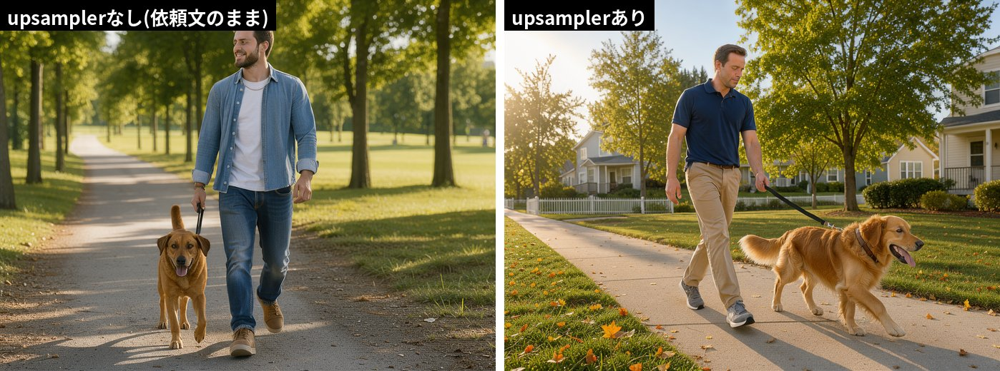

この例では、依頼文のままでも破綻はしませんでした。upsampler を通すと、光の向き・影・人物の服装・背景の家並みまで決めて書くので、
光と構図が作り込まれた絵になります。どちらがよいかは好みですが、狙った絵を毎回安定して出すには、upsampler を通すか、
同じくらい詳しく書くのが確実です。

### 3.2 写真(商品写真)

- 依頼文: `A product photo of a matte black ceramic coffee dripper on a light oak table`(1024×1024)
- キャプション(抜粋): *Studio photograph, soft diffused side lighting from the upper right that creates a gentle gradient across the subject
  and casts a soft shadow toward the lower left. In the center of the frame, a matte black ceramic coffee dripper with a conical shape
  and vertical interior ribs sits atop a clear glass server ...*

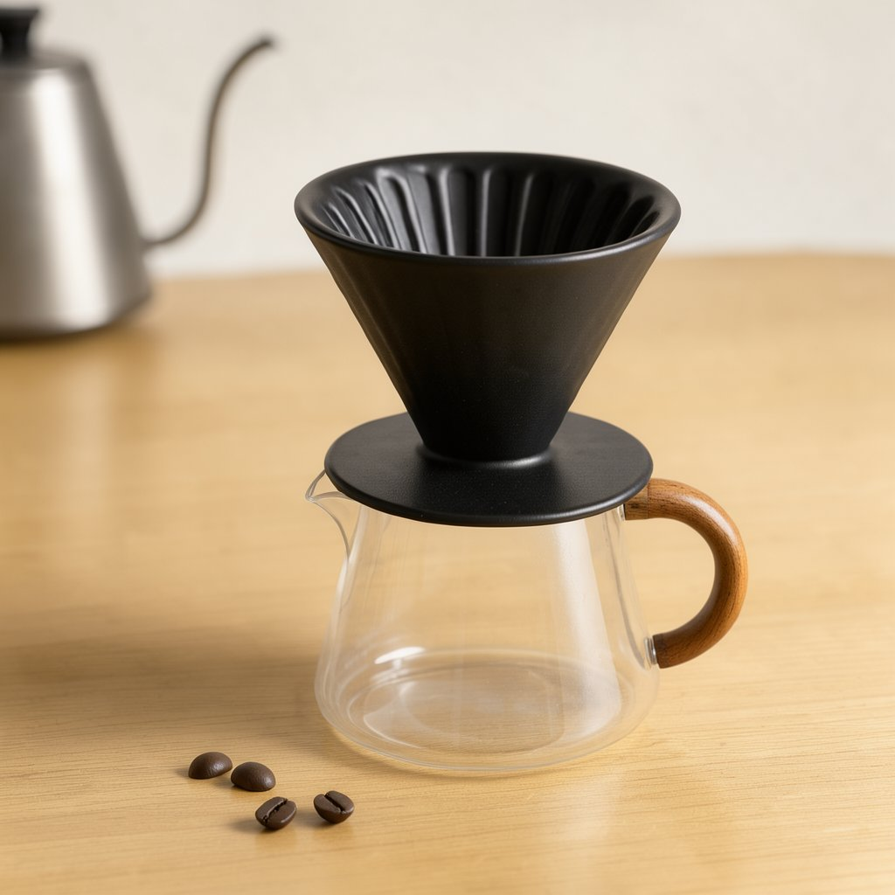

依頼にない「ガラスのサーバー」「ケトル」「コーヒー豆」を、場面に合う小物として upsampler が足しています。
小物を増やしたくないときは、依頼文に `only the dripper, nothing else on the table` のように書きます。

### 3.3 文字入り(ポスター)

- 依頼文: `A poster for a jazz night at a small bar, titled 'Blue Moon Session', on Nov 21`(768×1024)
- キャプション(抜粋): *Flat vector illustration with a vintage mid-century modern aesthetic, designed as a vertical event poster ...
  a large block of stylized, bold sans-serif text in navy blue reads "BLUE\nMOON\nSESSION" ...*

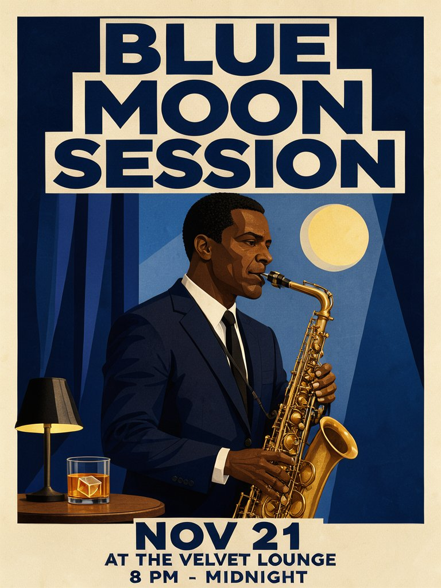

タイトルと日付は指定どおり描かれました。一方で、依頼にない「AT THE VELVET LOUNGE / 8 PM - MIDNIGHT」も描かれています。
upsampler は、ポスターらしく仕上げるために文字を書き足すことがあります。文字を正確にしたいときは、「展開して確認」でキャプションを出し、
余計な文字(引用符で囲まれた部分)を消してから生成します。

### 3.4 画風(水彩)

- 依頼文: `A rainy evening street in old Kyoto as a soft watercolor illustration`
- キャプション(抜粋): *Watercolor illustration of a narrow, rain-slicked street in old Kyoto during a quiet evening, rendered with soft,
  bleeding edges and a muted palette of indigo, charcoal grey, and warm amber ...*

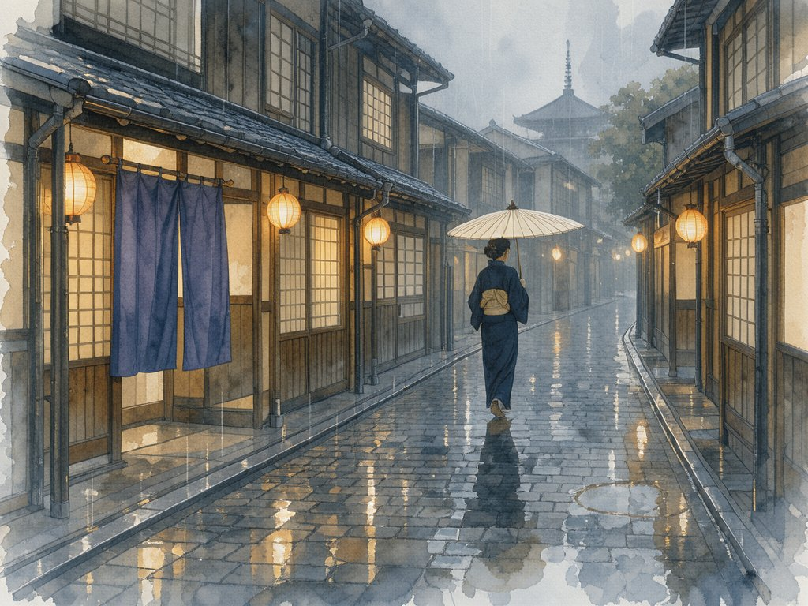

画風は、upsampler が「にじんだ輪郭」「藍・チャコール・琥珀の落ち着いた配色」のような特徴の言葉に置き換えて書きます。

### 3.5 日本語の依頼

- 依頼文: `夕暮れの海辺を走る白い犬`
- キャプション(抜粋): *Full-color outdoor photograph, shot from a low angle to emphasize the motion of the subject. The scene is set at dusk,
  with the sky transitioning from a deep indigo at the top to streaks of orange and magenta along the horizon ...*

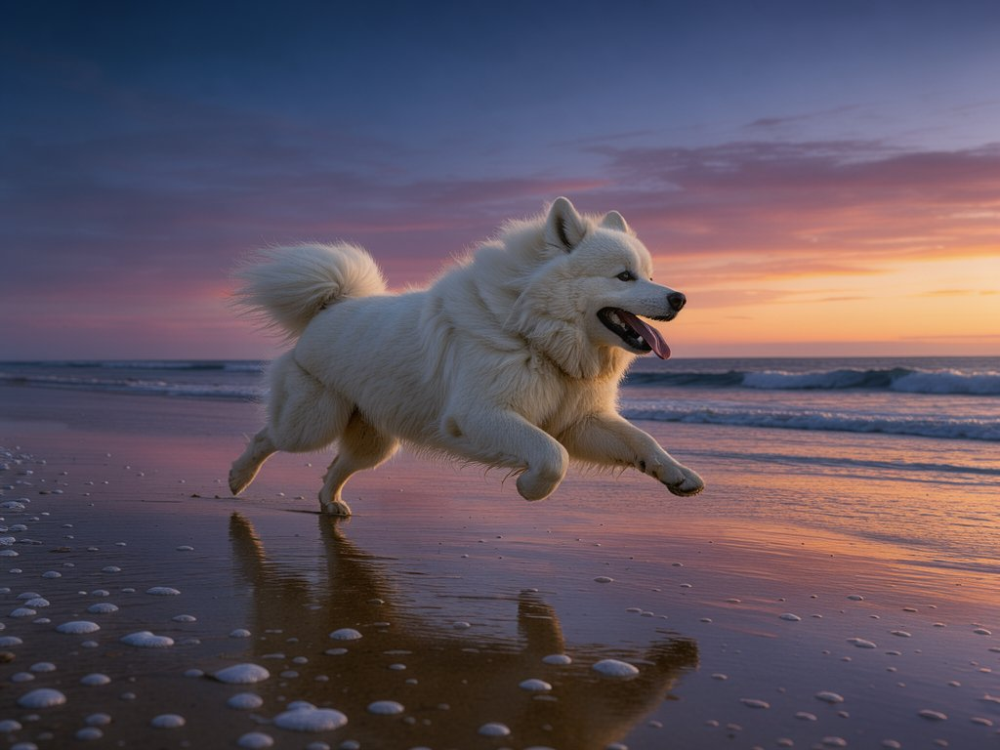

依頼文は日本語でも、upsampler が英語のキャプションに直します。

---

## 4. 参照画像 1 枚の編集

この節の参照画像は、カフェで撮ったキャラクターのキー画像(768×768、手にバッグ)です。出力は 768×1024。

### 4.1 物を消す

- 依頼文: `Remove the handbag.`
- キャプション: *Remove the dark blue handbag held in the woman's right hand on the left side of the image, filling the space with the
  white fabric of her dress and the background cafe interior, including the wooden tables and chairs. Keep the woman, her clothing,
  and the rest of the scene untouched.*

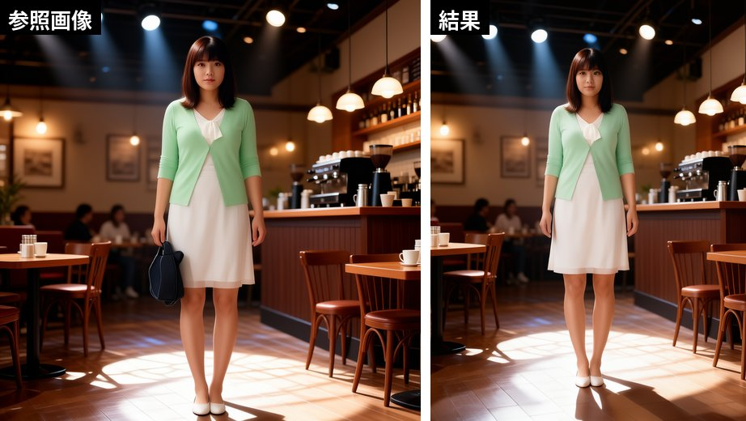

upsampler は、消すものを見た目と位置で特定し、消した後に何で埋めるか、何を残すかまで書きます。

### 4.2 色を変える

- 依頼文: `Change her cardigan to navy blue.`
- キャプション: *Change the color of the light green cardigan worn by the woman to a deep navy blue. Ensure the fabric texture and the way
  it drapes over her white dress remain the same. Keep the woman's appearance, the white dress, the dark blue bag she is holding, and
  the entire cafe background untouched.*

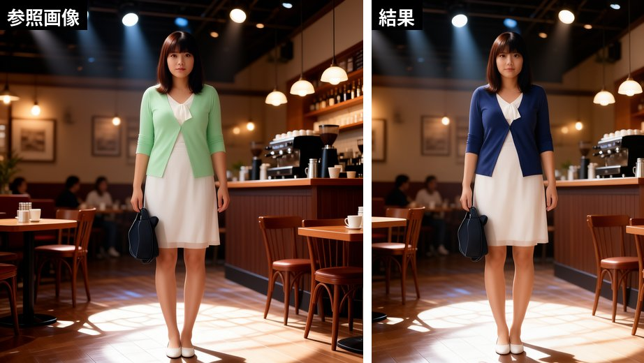

### 4.3 画風を変える

- 依頼文: `Convert the entire image into a watercolor illustration.`

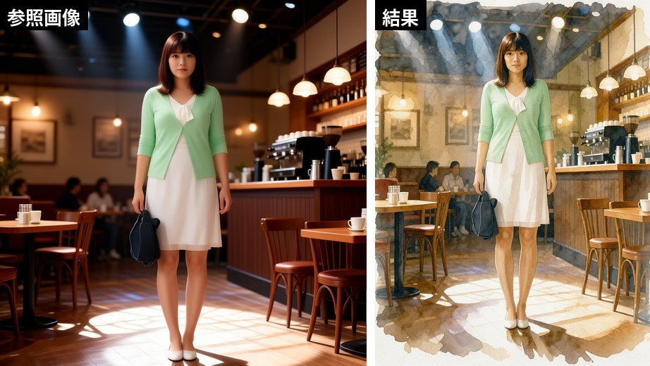

人物・服・カフェの配置はそのまま、全体が水彩画になりました。

### 4.4 背景を変える(白背景の参照画像を作る)

- 依頼文: `Put her on a plain white studio background as a full-body front view with both hands empty (remove the handbag).`
- キャプション(抜粋): *Create a full-body photograph of the woman from the first image, positioned in a front-facing view against a plain,
  seamless white studio background. She must retain her exact appearance, including her facial features, dark shoulder-length hair,
  light green cardigan, white knee-length dress, and white pointed-toe shoes. Remove the ...*

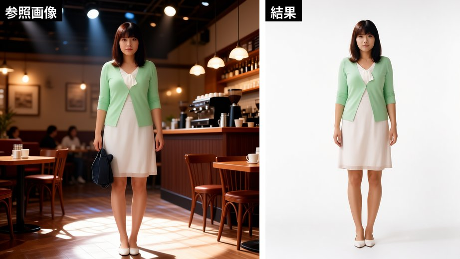

背景の除去・バッグの除去・全身の正面向きを 1 回でこなします。動画生成などで使う、キャラクターの参照画像づくりに向いています。

### 4.5 視点を変える

視点の変更は、書き方で結果が大きく変わりました。

- 依頼文 1: `Shift the camera viewpoint to a low angle from her left side.`
- 依頼文 2: `Show her from a low camera angle near the floor, looking up at her, with the cafe ceiling lights visible above her.`

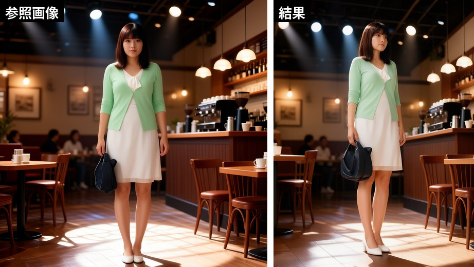

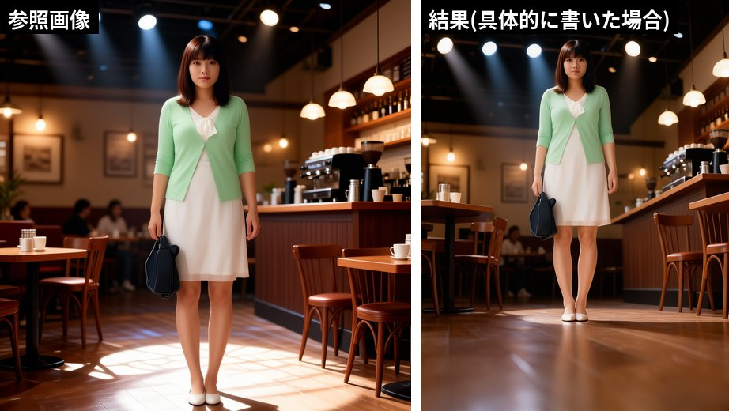

依頼文 1 では、ほとんど変わりませんでした。依頼文 2 のように、**カメラの高さと、そこから何が見えるか**(床に近い・見上げる・天井の照明が頭上に)
を具体的に書くと、床が大きく写るローアングルになりました。

### 4.6 1 行の編集指示をそのまま送ると

モデルカードは「1 行の編集指示をそのまま送ると、構図まで変わる」と注意しています。同じ参照画像・同じ seed で比べました。

- upsampler なし: `Make her cardigan navy blue.` をそのまま送る
- upsampler あり: `Change her cardigan to navy blue.`(4.2 節と同じ)

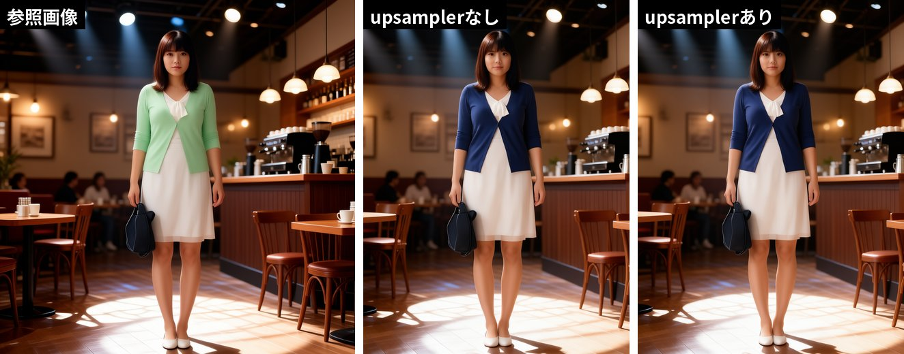

この例では、upsampler なしでも構図は崩れず、色だけが変わりました。単純な色の変更なら 1 行でも通ることがあります。
ただ、何を残すかが書かれていないので、複雑な編集ほど結果が不安定になります。迷ったら upsampler を使います。

---

## 5. 複数の参照画像

1 枚目には 4.4 節で作った白背景の参照画像を使います。2 枚目は T2I で作りました。

### 5.1 キャラクター + 場所

- 依頼文: `Have the woman from the first image stand at the head of the table in the conference room from the second image, presenting to colleagues in navy suits.`
- キャプション(抜粋): *Create a photograph of the woman from the first image, maintaining her exact appearance, including her dark hair with bangs,
  her light green cardigan, her cream-colored knee-length dress, and her white pointed-toe heels. Position her standing at the head of
  a polished wooden conference table ...*

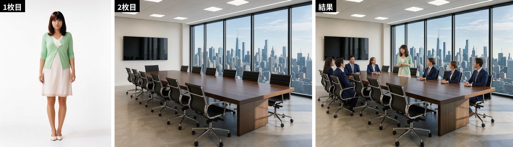

会議室の窓・テーブル・椅子の並びは 2 枚目のまま、人物と同僚が加わりました。場所の画像を用意しておけば、シーンをまたいで場所をそろえられます。

### 5.2 キャラクター + 服

- 依頼文: `The woman from the first image wearing the red coat from the second image, walking down a city street in autumn.`

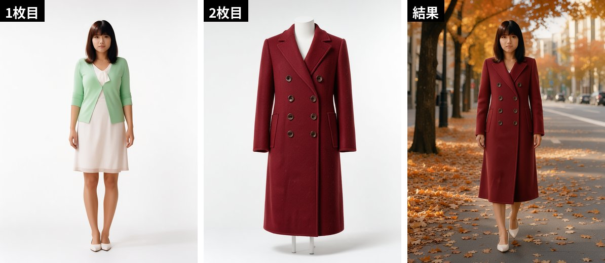

顔と髪は 1 枚目、コートは 2 枚目(ダブルのボタンや襟の形まで)から取られています。

### 5.3 画風のお手本(うまくいかない例)

- 依頼文 1: `Draw the woman from the first image reading a book in a cafe, in the style of the second image.`
- 依頼文 2: `Draw the woman from the first image reading a book at a table in a cozy cafe interior. Take only the painting style of the second image (soft watercolor washes, muted blue-grey palette, paper texture), not its street scene.`

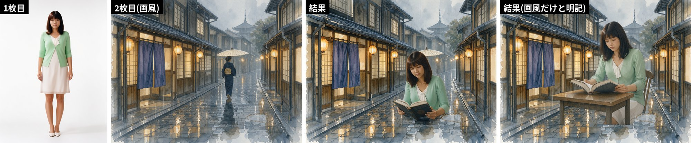

どちらも水彩の画風にはなりましたが、2 枚目の「雨の京都の通り」まで持ち込まれ、カフェになりませんでした。「通りの場面は使わない」と書いても同じでした。
画風の参照画像は、場面ごと取り込まれやすいようです。画風だけを変えたいときは、参照画像を使わず、**画風を言葉で書く**(3.4 節、4.3 節)ほうが確実です。

---

## 6. アウトペイント

正方形の画像の周りを描き足して、横長にします。画面の「FLUX 3アウトペイント」をオンにし、参照画像を 1 枚だけ選びます(API では `outpaint=true`)。

- 依頼文: `Extend the cafe to the left and right with more tables, chairs and warm pendant lights, keeping the woman unchanged in the center.`
- 出力: 1024×768

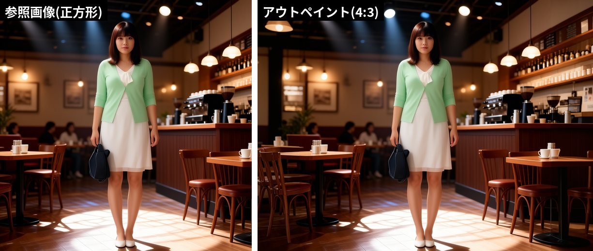

中央の元の画像はそのまま残り(生成後に貼り戻します)、左右にテーブルと照明が描き足されました。依頼文には、**広げる方向と、そこに何を描くか**を書きます。

---

## 7. 位置指定(バウンディングボックス)

物を置く位置を枠で指定します。座標は画像の左上を (0, 0)、右下を (1000, 1000) とした `[上, 左, 下, 右]` です。
**依頼文の中で、各物を `<id>` の形で引用**するのが決まりです(例: `a red apple <apple_1>`)。

upsampler を使うと、枠は「固定の注釈」として upsampler に渡され(`t2i_bbox` / `i2i_bbox` モード)、
upsampler はキャプションの本文で `<id>` を引用し、末尾に枠の表を付けます。枠の ID と座標は、あなたが指定した値に戻されます。

### 7.1 T2I: 物を並べる

**1. 出力サイズを選び、依頼文を書く。** 物ごとに `<id>` を付けます。

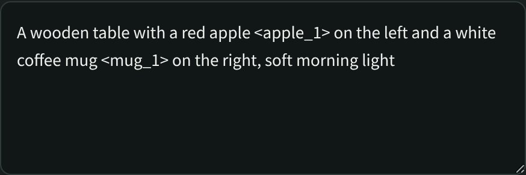

**2. 「レイアウト指定」を開き、枠を描く。** キャンバスの上をドラッグすると枠ができます。キャンバスの縦横比は出力サイズに合わせて変わります。

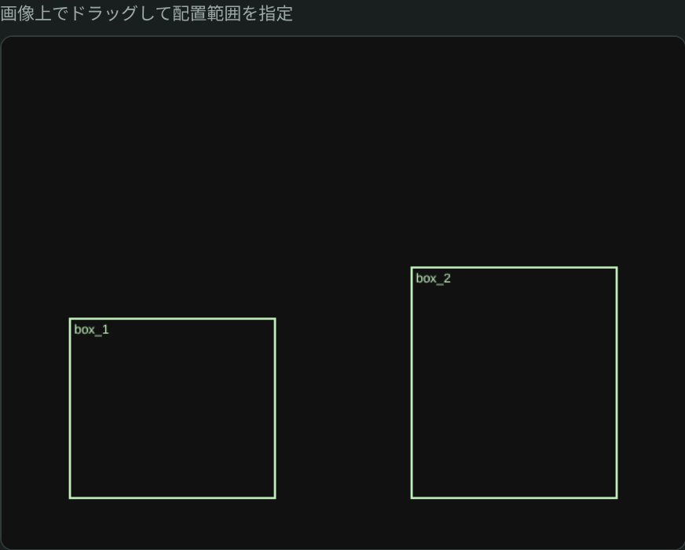

**3. JSON の ID と説明を直す。** 描いた枠は `box_1`, `box_2` という ID になるので、依頼文の `<id>` に合わせて書き換えます。`desc` には物の説明を書きます。

```json
[
  {"id": "apple_1", "bbox": [550, 100, 900, 400], "desc": "A shiny red apple with a green leaf"},
  {"id": "mug_1", "bbox": [450, 600, 900, 900], "desc": "A white ceramic mug of black coffee"}
]
```

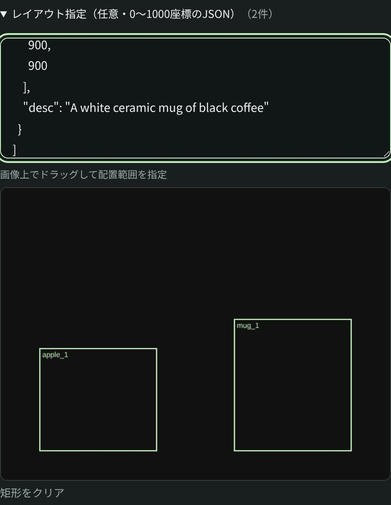

**4.(任意)「✦ prompt upsamplerで展開して確認」で、キャプションを確かめる。**

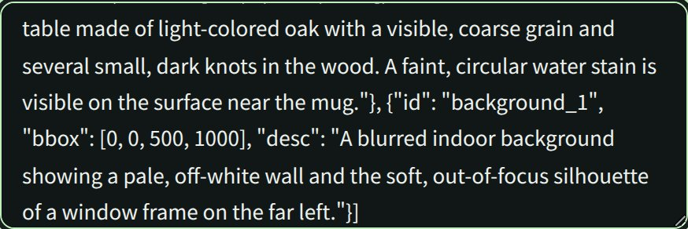

展開されたキャプション(抜粋): *Full-color indoor photograph of a wooden table <table_1> bathed in soft morning light coming from the side.
In the center foreground, a shiny red apple <apple_1> sits on the left side of the table surface. To the right, a white ceramic mug <mug_1>
filled with black coffee rests on the wood. The background <background_1> is ... [{"id": "apple_1", "bbox": [550, 100, 900, 400], ...}, ...]*

upsampler は、テーブル(`<table_1>`)と背景(`<background_1>`)の枠を自分で足しています。本文で引用された枠だけが残ります。

**5. 生成する。**

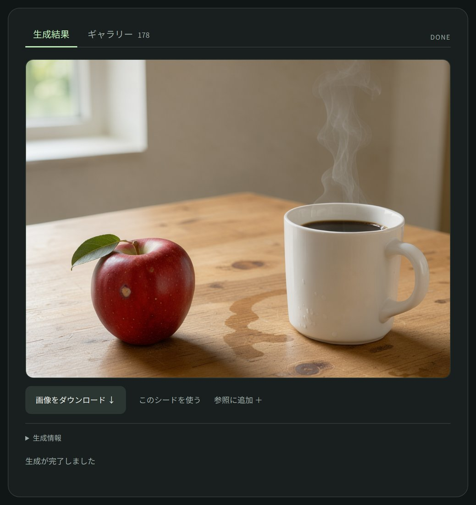

リンゴは左、マグは右の枠どおりの位置・大きさで描かれました。

### 7.2 編集: 物を足す

**1. 参照画像を選ぶ。** キャンバスに参照画像が表示され、キャンバスの縦横比も画像に合わせて変わります
(ギャラリーや生成結果の画像を、参照画像の欄にドラッグ&ドロップしても選べます)。

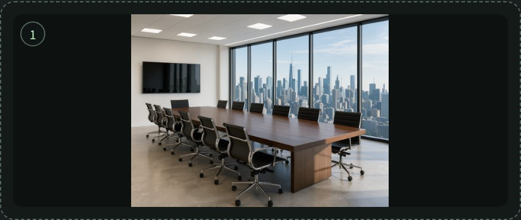

**2. 依頼文を書き、置きたい場所に枠を描く。**

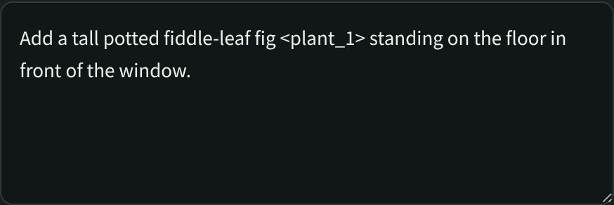

**3. JSON を編集用に直す。** 新しく足す物は、`bbox` を `tgt_bbox`(置く場所)に変え、`src_bbox` を `null` にします。

```json
[
  {"id": "plant_1", "from": "target", "src_bbox": null, "tgt_bbox": [300, 700, 950, 950],
   "desc": "A tall potted fiddle-leaf fig in a white pot"}
]
```

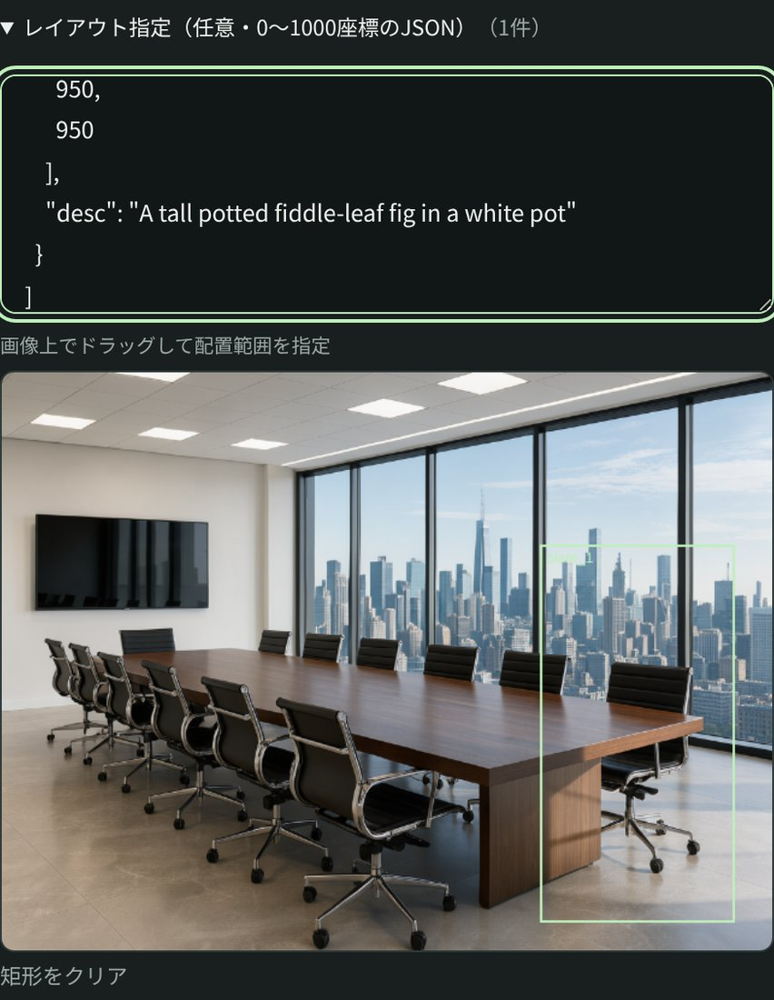

**4. 生成する。**

- キャプション(upsampler が書いたもの): *Add a tall potted fiddle-leaf fig <plant_1> standing on the floor in front of the window on the right,
  matching the bright daylight and casting a soft shadow on the floor. Keep the conference table, chairs, and the city skyline view untouched.
  [{"id": "plant_1", "from": "target", "src_bbox": null, "tgt_bbox": [300, 700, 950, 950], ...}]*

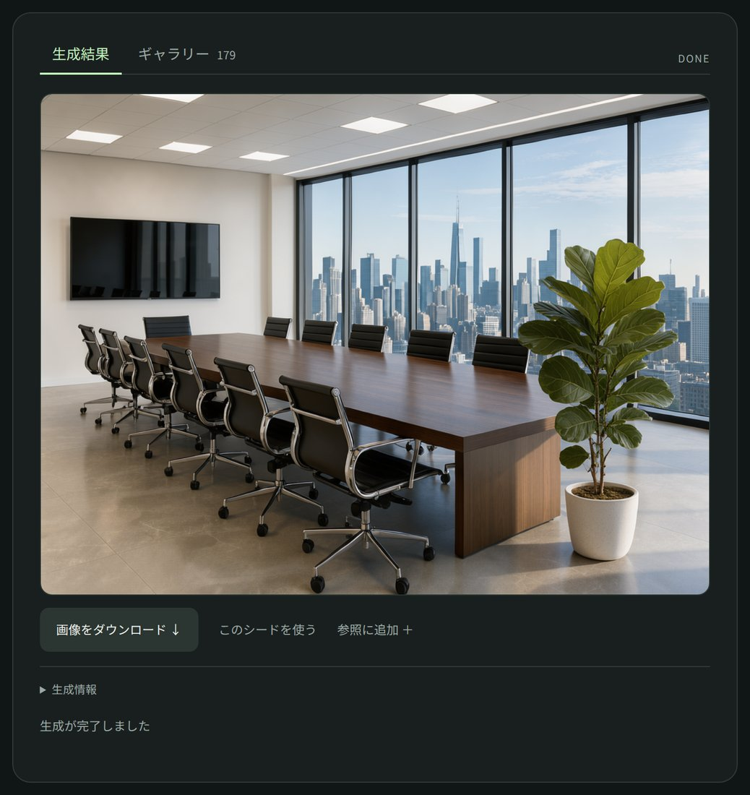

### 7.3 編集: 物を消す・動かす

| したいこと | 書き方 |
|---|---|
| 消す | `src_bbox` に今の位置、`tgt_bbox` に `null` |
| 足す | `src_bbox` に `null`、`tgt_bbox` に置く位置、`from` は `"target"` |
| 動かす | `src_bbox` に今の位置、`tgt_bbox` に動かす先 |
| どの参照画像の物か | `from` に `"ref_image_0"`(1 枚目)、`"ref_image_1"`(2 枚目)…。依頼文では `<ref_image_0>` のように引用できる |

例: キー画像のバッグを、位置を指定して消す。

- 依頼文: `Remove the handbag <bag_1>.`
- 枠: `[{"id": "bag_1", "from": "ref_image_0", "src_bbox": [560, 350, 730, 440], "tgt_bbox": null, "desc": "black handbag"}]`
- キャプション: *Remove the black handbag <bag_1> from <ref_image_0>, filling in the woman's white dress and the cafe background behind it.
  Keep the woman and the rest of the scene untouched. [{"id": "bag_1", "from": "ref_image_0", "src_bbox": [560, 350, 730, 440], "tgt_bbox": null, ...}]*

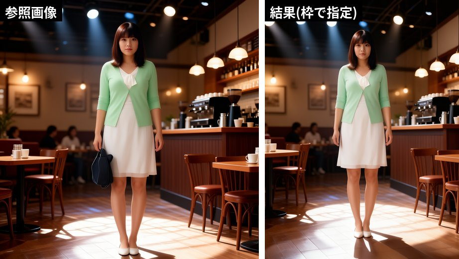

### 7.4 注意

- 枠は「だいたいの位置と大きさ」の指示です。ピクセル単位のマスクではないので、物が少しはみ出したり、小さい物が現れなかったりします。
- 編集では、枠の外が変わることもあります。
- 依頼文で `<id>` を引用していない枠は、upsampler の出力では使われないことがあります。

---

## 8. うまくいかないとき

| 症状 | 試すこと |
|---|---|
| 平凡な絵になる | upsampler をオンにする。オフのままなら、媒体・照明・カメラ・被写体ごとの外見と位置まで書く |
| 依頼にない文字が描かれる | 「展開して確認」でキャプションを出し、余計な文字を消してから生成する |
| 依頼にない小物が増える | 依頼文に「〜だけ」「他には何も置かない」と書く |
| 視点・カメラの変更が効かない | カメラの高さ・向き・そこから何が見えるかを具体的に書く(4.5 節) |
| 画風の参照画像の場面まで入る | 画風を言葉で書き、参照画像は使わない(5.3 節) |
| 参照の構図・場所がずれる | 公式 upsampler(`pup-int8` / `pup-gguf`)を試す。参照画像を「変えない土台」として書くので、構図を保ちやすい |
| 複数参照で誰が何かが混ざる | 「1 枚目の女性」「2 枚目のコート」のように、何枚目から何を取るかを書く |
| 結果が毎回大きく違う | seed を固定して(「このシードを使う」)、依頼文だけを変えて比べる |
